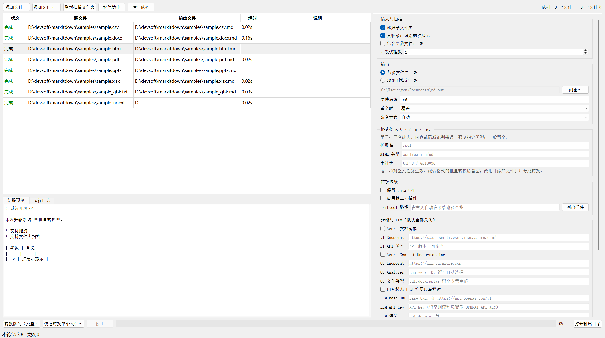

# MarkItDown GUI（Windows 桌面版）

把 [markitdown](https://github.com/microsoft/markitdown) 的命令行包成一个 Windows 图形界面程序：可以单个文件转，也可以整目录批量转，markitdown 能调的参数全部摆在界面上。默认走离线转换，目标机器不需要装 Python；要用云端能力（文档智能 / Content Understanding / LLM 图片描述）再自己开启。



*截图由 `scripts/make_screenshot.py` 真实跑完 `samples/` 全部 8 个文件后抓取，不是设计稿。*

## 它解决什么

官方 CLI 一次只能处理一个文件，输出路径、重名冲突、子目录结构、参数组合都得靠命令行记忆。这个项目把这些变成界面上的勾选和填表，并且加了批量调度。

## 功能

- **单文件快速转换**：选源文件 → 选保存位置 → 直接出 `.md`，不用先入队。
- **批量转换**：添加文件、添加文件夹（递归扫描，可按可识别扩展名过滤，可选是否包含隐藏文件/目录）。
- **多线程**：默认 2 线程，可调。每个线程复用一个 `MarkItDown` 实例，magika 的 onnx 模型只初始化一次；任务按步长切片分配，避免某一线程空转。
- **输出编排**：与源文件同目录 / 输出到指定目录；自定义后缀；重名策略（覆盖 / 跳过 / 自动加序号）；命名方式（重名才保留原扩展名 / 总是保留）。输出路径在开跑前单线程统一分配，混合目录里同名文件不会互相覆盖。
- **结果预览与日志**：双击某一行在「结果预览」里读它生成的 Markdown；「运行日志」记录每个失败项的原因；底部「打开输出目录」用资源管理器定位产物。
- **参数全量映射**：见下表，含 Azure 文档智能、Azure Content Understanding、多模态 LLM 图片描述（默认全部关闭）。
- **配置自动记忆**：关窗口时把当前参数写回配置文件，下次打开还在；API Key 默认不落盘。
- **高 DPI 自适应**：按真实缩放比例渲染（150% 不会进位成 200%），窗口默认尺寸跟随屏幕工作区。

## 支持的格式

默认可识别 46 种扩展名：

| 类别 | 扩展名 |
| --- | --- |
| 办公文档 | `.pdf` `.docx` `.xlsx` `.xls` `.pptx` `.ppsx` `.sldx` `.thmx` `.msg` |
| 网页与数据 | `.html` `.htm` `.xml` `.csv` `.json` `.zip` `.epub` `.ipynb` |
| 纯文本与代码 | `.txt` `.md` `.markdown` `.log` `.ini` `.conf` `.yaml` `.yml` `.tex` `.bib` `.py` `.js` `.ts` `.css` `.sql` |
| 图片 | `.png` `.jpg` `.jpeg` `.gif` `.bmp` `.tiff` `.tif` `.webp` |
| 音频 | `.wav` `.mp3` `.m4a` `.aac` `.ogg` `.flac` |

几点要注意：

- 老版二进制格式 `.doc` / `.ppt` / `.rtf` 离线转换不支持，所以没进默认列表；需要它们请勾选 Azure 文档智能或 Content Understanding。
- 没有扩展名的文件也能转，magika 会按内容识别类型；识别错了用「格式提示」里的扩展名 / MIME / 字符集强制指定。
- 图片转文字、音频转写需要额外配置（LLM 或 Azure 服务），纯离线只会输出元数据。

## 快速开始

### 直接用打包好的程序

```bat
:: 在本仓库根目录执行，产物在 dist\MarkItDownGUI\
.venv\Scripts\pyinstaller.exe --noconfirm build.spec
```

把整个 `dist\MarkItDownGUI\` 目录拷到目标机器（约 285 MB），双击里面的 `MarkItDownGUI.exe` 即可。

**不能只拷 exe。** 它是 PyInstaller 的目录模式产物，`MarkItDownGUI.exe` 必须和同级的 `_internal\` 一起存在，单独拿走必定启动失败。目标机器不需要安装 Python。

用起来的默认路径就三步：

1. 「添加文件夹…」选中放资料的目录，队列里会列出命中的文件（只想转某几个就用「添加文件…」）。
2. 右侧确认输出位置（默认与源文件同目录）和重名策略，点「转换队列（批量）」。
3. 跑完双击任意一行看生成的 Markdown，或点「打开输出目录」。单个文件想省事直接点「快速转换单个文件…」。

### 从源码运行

```bat
python -m venv .venv
.venv\Scripts\python.exe -m pip install -U pip

:: 国内网络建议加镜像，实测速度从 70–115 kB/s 提到 MB/s 级
set IDX=-i https://pypi.tuna.tsinghua.edu.cn/simple

.venv\Scripts\pip.exe install %IDX% "markitdown[all]"
.venv\Scripts\pip.exe install %IDX% openai
.venv\Scripts\pip.exe install %IDX% PyQt5

:: 启动界面
.venv\Scripts\pythonw.exe app_entry.py
:: 或者
.venv\Scripts\python.exe -m markitdown_gui
```

`markitdown[all]` 不含 `openai`，界面上的「多模态 LLM 图片描述」需要它。

当前构建实测版本：`markitdown==0.1.6`、`magika==0.6.3`、`onnxruntime==1.20.1`、`PyQt5==5.15.10`、`pyinstaller==6.22.3`。

## 界面参数 ↔ markitdown 开关

| 界面分组 | 对应开关 |
| --- | --- |
| 格式提示：扩展名 / MIME 类型 / 字符集 | `-x` / `-m` / `-c` |
| 保留 data URI | `--keep-data-uris` |
| 启用第三方插件 / 列出插件 | `-p --use-plugins` / `--list-plugins` |
| exiftool 路径 | Python API 参数，CLI 没有对应开关 |
| Azure 文档智能 | `-d --use-docintel`、`-e --endpoint` |
| Azure Content Understanding | `--use-cu`、`--cu-endpoint`、`--cu-analyzer`、`--cu-file-types` |
| 多模态 LLM 图片描述（Base URL / Key / 模型 / 提示词） | Python API 参数，CLI 没有对应开关 |
| 输出目录 / 后缀 / 重名时 / 命名方式 / 递归 / 并发线程数 | 本 GUI 独有，CLI 只有 `-o` |

「格式提示」三项对整批任务生效。混合格式的批量转换请留空，改用「添加文件」后分批转换。

## 配置文件与密钥

配置写在 `%APPDATA%\MarkItDownGUI\config.json`：启动时读回，关闭窗口时自动保存。右侧面板底部「配置」一组还有 保存 / 另存为… / 载入… / 默认值 / 配置目录 五个按钮，可以把一套参数存成文件带到另一台机器。

密钥处理规则：

- LLM API Key 只有在勾选「把 API Key 明文存进本地配置文件」时才会写进 `config.json`，默认不勾选，保存时该字段直接留空。
- 留空时回退读环境变量 `OPENAI_API_KEY`。
- Azure 密钥只从环境变量 `AZURE_DOCUMENT_INTELLIGENCE_KEY` / `AZURE_AI_SERVICES_KEY` 读取，界面上不提供输入框，也就不会被写进任何文件。

「默认值」按钮会同时关掉密钥持久化勾选。

## 自测

```bat
.venv\Scripts\python.exe scripts\verify_engine.py     :: 引擎层 16 项，约 40 秒
.venv\Scripts\python.exe scripts\smoke_ui.py          :: 离屏冒烟：界面构建、队列、校验、配置读写
.venv\Scripts\pyinstaller.exe --noconfirm build.spec  :: 约 106 秒
.venv\Scripts\python.exe scripts\verify_exe.py        :: 打包产物 9 项
```

`verify_exe.py` 先真实调用 `MarkItDownGUI.exe --selftest 输入 输出` 跑一遍 `samples/`（含无扩展名文件）并核对输出内容，再启动一次带界面的 exe 检查进程存活和窗口标题——windowed 程序没有 stdout，所以自检结果写成 `.selftest.log` 文件再读回。

`samples/` 里是 8 个测试文件（含一个 GBK 编码文本和一个无扩展名文件），`scripts/make_samples.py` 可重新生成。

## 目录结构

```
app_entry.py                 PyInstaller 入口（也用于 pythonw 直接启动）
build.spec                   打包配置
src/markitdown_gui/
  engine.py                  转换引擎：参数、校验、路径规划、批量执行，不依赖 UI
  settings.py                配置读写与密钥处理
  ui_main.py                 主窗口、表格、线程池调度
  __main__.py                python -m 入口，含 --selftest
scripts/                     生成样例、图标、本 README 截图，以及三个验证脚本
samples/                     回归测试用输入文件
assets/                      图标与本 README 的截图
docs/                        设计与部署文档（HTML）
```

## 已知限制

- 打包只针对 Windows；界面用 PyQt5，跨平台需要自己验证。
- 窗口从 150% 缩放的屏幕拖到 100% 缩放的屏幕，Qt5 不会重新缩放，重启程序才正确。
- 逻辑工作区宽度低于约 1200 px 时（例如 1366×768 开了 125% 缩放，只剩 1093×614），右侧参数面板需要横向滚动，窗口高度下限也可能顶到任务栏。
- 云端能力（文档智能 / Content Understanding / LLM 描述）需要网络和有效订阅，关闭时不影响其他功能。
- 桌面拖拽进窗口未纳入自动化验证。

## 更多文档

[设计与部署文档](docs/MarkItDown-GUI-设计与部署文档.html) —— 架构图、转换流水线、并发模型、命名与冲突策略、打包体积构成、部署步骤、故障排查。用浏览器打开即可，图可缩放、可看 Mermaid 源码，也可下载单文件副本。

## 许可与致谢

核心转换能力来自 Microsoft 的 [markitdown](https://github.com/microsoft/markitdown)（MIT），内容类型识别来自 [magika](https://github.com/google/magika)（Apache-2.0）。本仓库只包含 GUI 与打包配置，遵循上游 MIT 许可。
